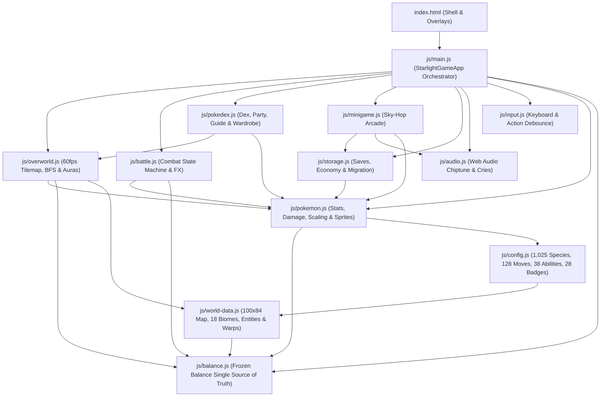

# Pokémon: Starlight Island — System Architecture

This document describes the runtime architecture, module boundaries, data flow, and quality gates of **Pokémon: Starlight Island** — a zero-build, offline-first retro handheld Pokémon RPG built for **Violet & Ozias** across phones, tablets, Chromebooks, and desktops.

For balance tuning dials and combat/XP math tables, see [`docs/BALANCE.md`](./docs/BALANCE.md). For contributor and AI-agent guardrails, see [`AGENTS.md`](./AGENTS.md).

---

## 1. High-Level Design Principles

1. **Zero-Build Native ES6 Modules:** The app runs directly from static HTML, CSS, and native ES6 `<script type="module">` files (`./js/*.js`) with zero bundlers, zero build step, and zero runtime npm dependencies.
2. **Static GitHub Pages Portability:** Every internal URL uses relative `./` paths (`index.html`, `manifest.json`, `sw.js`, and all JS imports) so the game works identically at root (`/`) or under a GitHub Pages subpath (`/repo/`).
3. **Offline-First Progressive Web App:** `manifest.json` and `sw.js` precache the full runtime shell (`starlight-shell-v11`) and cache sprites on demand (`starlight-assets-v11`), while multi-tier fallbacks ensure zero broken images or audio even with airplane mode enabled.
4. **Dual Independent Trainer Profiles:** Violet and Ozias each have an isolated, persistent adventure slot stored inside a single schema-versioned `localStorage` payload (`starlight_pokemon_save_v1`) with lossless v1→v2 save hydration and automatic corruption repair.
5. **60fps Canvas + Semantic DOM Overlay Split:**
   - **Canvas Layers** handle high-frequency procedural rendering: the `100×84` overworld tilemap & Y-sorted actors (`js/overworld.js`), battle FX particles/projectiles (`js/battle.js`), and the Starlight Sky-Hop arcade (`js/minigame.js`).
   - **DOM Overlays** (`index.html`, `css/main.css`, `css/battle.css`, `css/controls.css`) handle accessible HUDs, touch controls, tactical readiness briefings, dialogue, battle command decks, and the Pokédex/Party/Guide/Wardrobe drawers.

---

## 2. Module Dependency Graph

The JS codebase forms a strict, cycle-free ES6 Directed Acyclic Graph (DAG). Pure configuration and balance math sit at the bottom; domain engines compose cleanly above them; `js/main.js` orchestrates screen transitions, modals, and cross-module callbacks.



### Module Ownership Map

| Module | Primary Responsibility | Key Imports |
| --- | --- | --- |
| `js/balance.js` | Zero-dependency frozen `BALANCE` table + pure combat/XP/readiness math helpers | *(none)* |
| `js/world-data.js` | `100×84` `WORLD_MAP`, 18 `BIOMES`, 20 `SHRINES`, 36 `CHESTS`, 23 `NPCS`, 23 `FIELD_QUESTS`, 17 `RIVAL_TRAINERS`, 20 `LANDMARKS`, 18 `SIGNPOSTS`, walkability, compass, `getPlayerLevel`, & zone warp resolvers | `balance.js` |
| `js/config.js` | 1,025 `SPECIES`, 18 `TYPES` & `TYPE_CHART`, 128 `MOVES`, 38 `ABILITIES`, 16 `EVOLUTION_ITEMS`, `EVOLUTIONS`, 28 `BADGES`, trainer cosmetics, `getSpriteUrls`, and `export * from './world-data.js'` | `world-data.js` |
| `js/pokemon.js` | `Pokemon` model, stat/damage/capture calculation, wild/shrine/trial/rival scaling, 10-archetype silhouettes, 4-tier `attachPokemonSprite`, re-exports `BALANCE` & readiness helpers | `config.js`, `balance.js` |
| `js/storage.js` | `StorageManager`, `starlight_pokemon_save_v1` persistence, v1→v2 hydration, Pokédex ancestor recovery, earned cheer/arcade economy invariants | `config.js`, `pokemon.js` |
| `js/audio.js` | Pure Web Audio chiptune synthesizer, 23 `THEMES`, 1,025 deterministic Pokémon cries, SFX, mobile gesture unlock | *(none)* |
| `js/input.js` | Unified keyboard (`WASD`/Arrows/`Enter`/`Space`/`Esc`/`P`/`H`/`W`/`1–4`) direction stack & debounced action dispatcher | *(none)* |
| `js/overworld.js` | 60fps canvas tilemap, pooled Y-sorted actors, lead companion follower, BFS tap-to-walk, hold/drag steering, discovery nodes, encounter grace, Shrine & Rival visual readiness auras | `balance.js`, `config.js`, `pokemon.js`, `world-data.js` |
| `js/battle.js` | 10-state combat engine, Composure guardrail feedback, tiered enemy AI, XP rubber-banding, procedural attack/capture FX canvas | `balance.js`, `config.js`, `pokemon.js` |
| `js/pokedex.js` | National Pokédex (1,025 entries), Party/Box management, Star-Rank upgrades, Evolution, Island Guide readiness cards, Trainer Wardrobe | `config.js`, `pokemon.js`, `overworld.js` |
| `js/minigame.js` | Secret unlockable Starlight Sky-Hop arcade loop (`760×420` canvas), wave patterns, charge/buy-in gates, reward caps | `config.js`, `pokemon.js`, `audio.js`, `storage.js` |
| `js/main.js` | `StarlightGameApp` top-level lifecycle, boot/profile flow, HUD & warp dock, `#encounter-briefing-modal`, dialogue/celebration queues, `?test=true` hook | All runtime modules |

---

## 3. Core Systems Breakdown

### 3.1 World & Wayfinding (`js/world-data.js`, `js/overworld.js`)

- **Tilemap & World Density:** `WORLD_MAP` is a `100×84` grid (6,403 walkable tiles) spanning **18 biomes** — Starlight Village (safe sanctuary with Healing Fountain, zero wild encounters) plus 17 themed encounter biomes (Whispering Forest through Terastal Crystal Crater and Mythic Starlight Rift).
- **100% Reachability Guarantee:** Every single one of the **134 interactive targets** (`20 SHRINES`, `36 CHESTS`, `23 NPCS`, `17 RIVAL_TRAINERS`, `20 LANDMARKS`, `18 SIGNPOSTS`) plus `SECRET_ARCADE_SPOT` (`11,12`) is verified 100% BFS-reachable from spawn `(8, 15)` on every CI run.
- **Direct-Touch & Hybrid Navigation:**
  - **Tap-to-Walk (`walkToTile`)**: Runs bounded BFS (up to 1,400 visited tiles) from the player's current/target tile. Tapping a non-interactive solid tile within Manhattan radius `1–2` of walkable terrain snaps forgivingly to the nearest reachable tile; tapping an interactive tile walks adjacent and auto-interacts on arrival.
  - **Hold/Drag Steering**: Holding or dragging (`>= 14px` or `>= 150ms`) enters continuous pointer steering with automatic perpendicular corner-slide assist around obstacles.
  - **Follower Companion**: The active party lead walks 1 tile behind the trainer using animated/static sprites with a 10-archetype pixel-art fallback when offline.
- **Discovery Nodes & Depth Tiers:**
  - Encounter tiles compute biome depth (`getTileDepthInfo`) and spawn glowing discovery nodes (`shimmer`, `starfall`, `mystery_cry`) managed in a non-repeating shuffle bag.
- **Overworld Encounter Pacing & Anti-Ambush Grace:**
  - Wild step cadence reads directly from `BALANCE.overworld` (`minStepsBetweenWilds: 5`, `wildEncounterChance: 0.19`, `maxEncounterStreak: 10`).
  - `OverworldEngine.grantEncounterGrace(steps)` sets a non-decreasing step buffer (`this.encounterGraceSteps`) automatically granted on `warpToPosition(...)` (`postWarpGraceSteps: 3`) and on post-escape/faint returns (`postEscapeGraceSteps: 3`). While active, each step decrements grace and suppresses random tall-grass ambushes while still allowing intentional stepping onto glowing discovery nodes or healing spots.
- **Visual Readiness Auras (60fps Zero-GC Cache):**
  - Uncleared Shrines and Rivals render ground aura rings and beacon pips tinted by readiness tier (`favored` emerald, `balanced` cyan-gold, `challenging` amber pulse, `danger` coral-red double warning ring).
  - Readiness tiers are lazily cached in dedicated per-ID maps (`_shrineReadinessCache`, `_rivalReadinessCache`) keyed by a lightweight profile signature throttled to `450ms` and invalidated on `syncFromProfile()` / `warpToPosition()`, keeping the 60fps canvas hot path allocation-free.
- **Starlight Compass & Instant Zone Warps:**
  - `getCompassObjective(profile)` dynamically guides players toward the next starter milestone, uncleared Shrine, or Dex completion with bearing arrows and tile distance.
  - **Safe-Zone Recall (`getSafeZoneWarpPoint`)** returns players beside the Starlight Village Healing Fountain without disturbing recent-warp rotation.
  - **Player-Level Farming Warp (`resolveFarmingBiomeForLevel`)** selects a spike-free biome anchored strictly to Trainer **Player Level** (never party/box levels) and rotates across similarly balanced zones using `recentWarpBiomes`.

---

### 3.2 Combat State Machine (`js/battle.js`, `css/battle.css`)

- **Deterministic 10-State Machine (`BATTLE_STATES`):**
  ```mermaid
  stateDiagram-v2
    [*] --> INACTIVE
    INACTIVE --> INTRO: startBattle()
    INTRO --> PLAYER_INPUT: entry abilities & ready
    PLAYER_INPUT --> ACTION_ANIMATING: Move / Ball / Potion / Switch / Run
    ACTION_ANIMATING --> CHECK_FAINT
    OPPONENT_AI --> OPPONENT_ANIMATING: chooseEnemyMove()
    OPPONENT_ANIMATING --> CHECK_FAINT
    CHECK_FAINT --> OPPONENT_AI: enemy still to act
    CHECK_FAINT --> RETURN_TO_INPUT: both sides standing
    CHECK_FAINT --> FORCED_SWITCH: player fainted & healthy bench
    CHECK_FAINT --> BATTLE_END: victory / caught / escaped / blackout
    FORCED_SWITCH --> RETURN_TO_INPUT: replacement sent out
    RETURN_TO_INPUT --> PLAYER_INPUT
    BATTLE_END --> INACTIVE
  ```
- **Concurrency & Soft-Lock Protection:** Every turn action acquires a monotonic lock token (`lockPlayerAction`), preventing rapid double-taps, race conditions across async animations, or orphaned timers when aborting/closing battles. Three pace presets (`cinema`, `classic`, `fast`) scale animation delays uniformly.
- **Turn Order & Mechanics:**
  - Turn priority compares effective SPD (including stat stages `[-4, +4]` at `±20%` per stage via `BALANCE.combat.stageStep`).
  - **128 Moves** across **18 Types** (`TYPE_CHART`) with STAB, shields (`0.68×` incoming), heals, stat buffs/debuffs, drain effects, and Bond endure/crit bonuses.
  - **38 Abilities** trigger across 4 lifecycle hooks: `entry`, `attack`, `defense`, and `turn_end`.
  - **4 Encounter Traits** (`curious`, `treasure`, `spirited`, `apex`) differentiate wild encounters with distinct catch, shard, XP, and damage modifiers.
- **Composure Anti-OHKO Guardrail:**
  - Passing `applyComposure: true` to `calculateDamage` protects full-HP combatants from turn-1 instant sweeps within fair level gaps (`playerFullHpMaxRatio: 0.72` ramping to `0.88` up to `+8` gap; `wildFullHpMaxRatio: 0.84` up to `+5` advantage; `bossFullHpMaxRatio: 0.65` up to `+8` gap), while stepping aside for huge veteran level leads. Triggering Composure surfaces a `🛡️ BRACED!` callout and battle log cue.
- **Tiered Enemy AI (`chooseEnemyMove`):**
  - Enforces a 0-PP `Struggle` fallback (`_isStruggle: true`).
  - Wild foes avoid wasting heals above 60% HP, avoid redundant Shields, and cap self-buffs at `+1`.
  - Rivals and Shrines cap buff-stacking (`+1` standard, `+2` Astral Trials), use tactical Shields/Heals around 25%–55% HP, and blend smart type selection with playful variety so fights feel rewarding and fair.
- **Procedural Battle FX Canvas:** Dedicated `<canvas>` overlay renders physical lunges, elemental beams/streams, hit-stop flashes, capture arcs/wobbles, and victory/shrine celebration bursts without external sprite sheets.

---

### 3.3 Centralized Balance Architecture (`js/balance.js`, [`docs/BALANCE.md`](./docs/BALANCE.md))

All combat, XP, scaling, overworld pacing, and readiness dials live in a single deep-frozen `BALANCE` object in `js/balance.js` (re-exported by `js/pokemon.js` and consumed by `world-data.js`, `overworld.js`, `battle.js`, `main.js`, and `pokedex.js`).

- **Three Decoupled Progression Anchors:**
  1. **Trainer Player Level (`getPlayerLevel`)** — Derived strictly from trainer milestones (`battlesWon`, `badges`, `shrinesCleared`, `rivalsDefeated`, trials, rematches, quests, unique Dex catches). **Never reads party or box levels.** Anchors wild biome scaling and farming warps.
  2. **Trainer Power Level (`getTrainerPowerLevel`)** — Weighted top-3 party average (`50% / 30% / 20%`, `65% / 35%` for 2, `100%` for 1) plus a capped badge bonus (`min(2.0, badges × 0.15)`). Anchors Shrine Guardians (`+1` max offset, `★3` cap), Astral Shrine Trials (`+1..+4`, `★2..★4`), and Rival Rematches (`+1..+4`, `★3` cap).
  3. **Party Readiness Level (`getPartyReadinessLevel` → `assessEncounterReadiness`)** — Weighted top-3 *healthy* party average combined with average HP ratio (`lowHpWarnRatio: 0.65`), faint count, and `TYPE_CHART` matchup checks to produce `favored` (`✅`), `balanced` (`⚖️`), `challenging` (`⚠️`), or `danger` (`🚨`) badges, counter-type hints, and kid-friendly tactical tips for `#encounter-briefing-modal`, overworld auras, interact pills, and the Island Guide.
- **Combat TTK Compression:**
  - `damageDivisor: 28`, softened stat ratio `clamp(atk/def, 0.45, 2.35)^0.78`, compressed type damage multipliers (`1.65×` / `1.35×` / `0.60×` while keeping canonical raw `effectiveness` intact for UI pills), and strictly monotonic offense soft-cap compression above `2.2×` (slope `0.45`).
- **XP Rubber-Banding & Smart Bench Share:**
  - Active battlers earn `baseXp = round((enemyLv × 11 + 10) × scale)` scaled by `getXpDeltaMultiplier` (`0.22×` floor when overleveled to stop snowballing, up to `1.65×` catch-up boost when underleveled).
  - Conscious bench teammates scale off un-tapered `baseXp` via `computeBenchXpShare` (`0.42` baseline, up to `0.78` catch-up share when trailing the active lead, tapering down to `0.20` when overleveled).

---

### 3.4 Persistence & Save Migration (`js/storage.js`)

- **Storage Contract:** Persists under a single `localStorage` key (`starlight_pokemon_save_v1`) with schema `version: 2`, storing `activeTrainer`, independent `profiles.violet` & `profiles.ozias` trees, and global audio/pace settings.
- **Lossless v1 → v2 Hydration (`validateAndRepairProfile`):**
  - Repairs missing fields, clamps out-of-range/non-finite (`NaN`, `Infinity`, negative, boolean) numbers to safe bounds, and preserves every caught Pokémon, badge, shrine clear, quest, cosmetic, and statistic.
  - **UID Deduplication:** Ensures every owned `Pokemon` across `team` (max 6) and `box` carries a globally unique `uid`.
  - **Pokédex Ancestor Recovery:** Reconciles `pokedex.caught` and `pokedex.seen` against `team`, `box`, and `starterId`, walking single-parent non-wild evolution edges backwards (`PARENTS_BY_SPECIES`) so evolved starters/gifts never lose credit for their pre-evolutions.
  - **Walkable Position Repair:** If a saved `(x, y)` lands out-of-bounds or on a solid tile (e.g., after map updates), `findNearestSafePosition` relocates the trainer to the nearest valid walkable tile.
- **Earned Economy Invariants:**
  - Fresh profiles start with `0` Star Shards and `0` Cheer Charges (strictly earned through play).
  - **Buddy Cheer:** `MAX_CHEER_CHARGES = 3`, earned every `25` overworld steps (`STEPS_PER_CHEER_CHARGE`), guarded against zero charges and max bond (`100`).
  - **Progression Guards:** `upgradePokemon` validates ownership & shard balance; `evolvePokemon` validates ownership, target rule, level requirement, and required Evolution Gem inventory; `pokedex.js` contains zero unguarded `.gainBond()` calls.

---

### 3.5 Resilient 4-Tier Sprite Fallback & 10-Archetype Visuals (`js/config.js`, `js/pokemon.js`, `js/overworld.js`)

Every Pokémon image (`attachPokemonSprite`) uses a race-safe `loadToken`, an in-memory `resolvedSpriteCache`, and a budgeted timeout cascade so sprites never stay blank, flash stale Pokémon, or break offline:

| Tier | Source | Behavior |
| --- | --- | --- |
| **1. Animated Sprite** | `#1–649`: PokéAPI Gen V Black/White animated `.gif`<br>`#650–1025`: PokéAPI Showdown animated `.gif` | Preferred live visual; capped to 45% of total load budget before falling through |
| **2. Static / Artwork PNG** | Standard PokeAPI front/back `.png`, falling back to front `.png` or `official-artwork` for newer gens | Seamless static fallback if animated GIF is missing or times out |
| **3. Local Precached Type SVG** | `./assets/fallback/<type>.svg` (18 type icons + `pokeball.svg`, precached in `sw.js`) | Rendered immediately as zero-flash placeholder and offline fallback |
| **4. Inline Archetype SVG / Pixel Art** | `generateSilhouetteDataUri(species, back)` & overworld follower pixel renderer | Zero-network data URI built from a compact 1,025-entry lookup into **10 body archetypes** (`biped`, `quadruped`, `winged`, `serpentine`, `aquatic`, `insectoid`, `draconic`, `construct`, `amorphous`, `flora`) |

---

### 3.6 Procedural Web Audio Engine (`js/audio.js`)

- **Chiptune Architecture:** Pure Web Audio API lookahead scheduler synthesizing 25%/50% duty-cycle pulse leads, harmonic arpeggios, triangle basslines, and filtered noise percussion — zero external MP3/OGG downloads.
- **Warm Mastering Bus:** All BGM, SFX, and cries route through a soft low-pass `masterFilter` (`1260Hz`, `Q = 0.65`) into `masterGain`, with per-theme channel gains capped at `<= 0.12` for kid-safe listening on phone/tablet speakers.
- **Mobile Gesture Unlock:** `unlock()` synchronously initializes and resumes `AudioContext` on the earliest `pointerdown`/`touchstart`/`keydown` event to satisfy Android Chrome and iPadOS Safari autoplay policies.
- **1,025 Deterministic Pokémon Cries:** `playPokemonCry(speciesOrId)` deterministically derives pitch contour, vibrato, timbre, and duration from species ID and type, giving all 1,025 Pokémon distinct offline cries.
- **23 Dynamic BGM Themes (`THEMES`):** Dedicated tracks for `title`, `overworld`, `battle`, `shrine`, `rival`, `arcade`, and all **17 encounter biomes** (`forest`, `cave`, `water`, `volcano`, `peak`, `grove`, `desert`, `marsh`, `sanctum`, `canyon`, `reef`, `ruins`, `rift`, `faeveldt`, `atoll`, `highlands`, `crater`).

---

### 3.7 Secret Arcade Mini-Game (`js/minigame.js`)

- **Starlight Sky-Hop:** A side-scrolling `760×420` canvas arcade (`3` hearts, curated `WAVE_TEMPLATES` of star rings, storm orbs, and clouds, plus Starlight Dash) featuring the trainer's active lead Pokémon.
- **Discovery & Unlock Loop:** Players attune the cabinet once they catch `5` species or earn `1` badge, then trigger **3 secret knocks** on the arcade cabinet at `SECRET_ARCADE_SPOT` (`11,12`) in Starlight Village to unlock it with `3` starting charges.
- **Anti-Farm Charge & Cooldown Loop:**
  - `MAX_ARCADE_CHARGES = 3`, recharged passively via **50 overworld steps** (`STEPS_PER_ARCADE_CHARGE`), **2 battle wins** (`BATTLES_PER_ARCADE_CHARGE`), or a **5 Star Shard buy-in** (`ARCADE_SHARD_BUYIN_COST = 5`).
  - Runs scoring below `MIN_ARCADE_REWARD_SCORE` (`80`) award zero loot; maximum Star Shard payout is strictly capped at `MAX_ARCADE_SHARDS = 4` (`< 5` buy-in cost) to prevent infinite shard loops.
  - Bonus Evolution Gems draw from badge-tiered pools (`BASE` → `MID` at 3+ badges → `ENDGAME` at 8+ badges) subject to `ARCADE_GEM_COOLDOWN_RUNS = 2`.

---

### 3.8 PWA Offline Shell & Automated CI/CD Gates

- **Service Worker (`sw.js`) & Manifest (`manifest.json`):**
  - `starlight-shell-v11` precaches all `CORE_SHELL_URLS` (100% parity with on-disk runtime HTML/CSS/JS/PNG/SVG files, excluding `tests/`, `scripts/`, and `.github/`), served **network-first** with cache fallback to `./index.html`.
  - `starlight-assets-v11` serves same-origin `/assets/` and cross-origin PokéAPI sprites **cache-first** (with stale-while-revalidate refresh for same-origin assets).
  - `manifest.json` configures standalone display, `#090d1a` theme, and `192×192` / `512×512` maskable PNG icons (+ `180×180` Apple touch icon).
- **Automated Verification Pipeline (`.github/workflows/ci-cd.yml`):**
  1. **Static CI Gate (`scripts/ci-static-gate.mjs`)** — 14 zero-dependency Node checks validating JS/MJS syntax (`node --check`), zero git conflict markers, `manifest.json` & PNG IHDR headers, `sw.js` `v11` cache constants & `CORE_SHELL_URLS` 100% disk parity, `README.md` `v11` parity, zero legacy D-Pad IDs in `index.html`, all 14 core dataset counts, `100×84` map geometry, 100% BFS walkability from `(8, 15)`, 100% `1..1025` National Dex reachability, and economy/cheer/arcade/evolution invariants.
  2. **Browser CI Gate (`scripts/ci-browser-gate.mjs`)** — Spins up a local `node:http` static server on `127.0.0.1:0` and drives headless Chromium through three stages:
     - **Stage A:** Runs the full in-browser automated regression suite (`?test=true` → `tests/test-runner.js`) at `1280×720` verifying zero `pageerror`, zero `console.error`, and zero local HTTP `>= 400` failures.
     - **Stage B:** Verifies zero HUD overflow, zero battle card/sprite overlap, zero Pokédex overflow, and visible Sky-Hop controls across a **6-viewport touch & desktop matrix** (`390×844`, `412×915`, `667×375`, `768×1024`, `1024×768`, `1280×720`).
     - **Stage C:** Registers the Service Worker, toggles browser offline mode, reloads from `starlight-shell-v11`, selects Violet, picks a starter, and verifies `#game-shell` boots cleanly offline.
  3. **GitHub Pages Deploy (`deploy-pages`)** — Automatically publishes the static root artifact to GitHub Pages on pushes to `main` only after both `ci-gate` checks pass.
